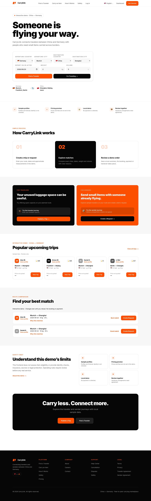

# CarryLink

**Someone is flying your way.**

[Live demo](https://carrylink-web.vercel.app/) · [GitHub repository](https://github.com/HaoWangOct/carrylink-web)

CarryLink is a multilingual marketplace prototype connecting travelers and senders between China and Germany. It turns a Figma concept into an interactive web experience, showcasing product flows, responsive design and frontend engineering with Next.js, React, TypeScript and Tailwind CSS.

> **Demo only:** Trips, matches and orders use sample data. Reloading the page resets the marketplace demo state. This prototype does not provide real transactions, payments, identity verification or delivery services. Do not enter real passwords, identity documents or sensitive information. The account demo API is disabled on public hosting.



## Features

- English, Chinese and German language switching across desktop, tablet and mobile layouts.
- Route search with linked country and city selections and shareable search URLs.
- Deterministic matching and sorting with sample data, match explanations and empty states.
- Traveler flows for creating, editing, pausing and resuming demo trips.
- Sender flows for entering item requests, reviewing matches and confirming demo orders.
- Registration and login UI prototypes, with the complete simulated account flow available only in local development.
- Form validation, keyboard-accessible dialogs and responsive navigation.

<details>
<summary>Mobile preview</summary>


</details>

## Run locally

Requires Node.js 22.13+ and npm. The showcase version requires no database, payment keys or third-party accounts.

```sh
npm ci
npm run dev
```

Open [http://127.0.0.1:3000](http://127.0.0.1:3000). Start with the homepage search, then try creating a trip or an item request. Sample dates are fixed in September 2026 and are demonstration fixtures.

| Page | Route |
| --- | --- |
| Homepage and route search | `/` |
| Match results | `/matches` |
| Traveler dashboard | `/dashboard` |
| Create a trip | `/trips/new` |
| Create an item request | `/requests/new` |
| Demo order review | `/orders/review` (open from match results) |
| Demo order details | `/orders/[id]` (open after creation; reset on reload) |
| Account UI | `/signup`, `/login` (complete simulated flow is local-only) |

## Stack and structure

Next.js 16 App Router · React 19 · strict TypeScript · Tailwind CSS 4 · Playwright Core.

```text
src/app/          Pages, layouts and local demo API
src/components/   Responsive UI and form components
src/content/      Translations, cities and sample data
src/mock/         In-memory marketplace state and matching logic
src/auth/         Account flow contracts and validation
src/server/auth/  Local account demo adapter
scripts/          Validation scripts
docs/             Architecture, decisions and task records
```

Inter is self-hosted with `next/font/local`; see its [font license](src/app/fonts/OFL.txt). Exact dependency versions are recorded in `package-lock.json`.

## Validation

```sh
npm run lint
npm run typecheck
npm run build
```

With the development server running, use a separate terminal for browser checks:

```sh
npm run test:browser
```

Browser checks use an existing Chrome, Edge or Chromium installation. Set `CHROME_PATH` if needed; the script does not download a browser. Coverage includes 1440, 768, 390 and 320 px layouts, language switching, keyboard dialogs, search, traveler and sender flows, and demo orders. Reports and original screenshots are written to the ignored `artifacts/` directory.

## Live demo and deployment

Visit [carrylink-web.vercel.app](https://carrylink-web.vercel.app/).

The application retains Next.js server routes and cannot be hosted directly as source on GitHub Pages. See the [deployment guide](docs/deployment.md) for the Vercel setup.

The public demo needs no environment secrets or database connection. Do not set `CARRYLINK_AUTH_MODE=demo` or enable local database diagnostics. The account demo API also restricts access to local hosts, so account services being unavailable on the public site is expected.

## Design and future work

Design reference: [CarryLink Figma Make](https://www.figma.com/make/UlMimbPJrGzAYss4ohiJyd/), historical reference node `0:1`. The showcase preserves the existing interface and operating boundaries.

Real authentication, persistent marketplace data, payments, messaging, handover and dispute handling remain future work. Operating a real service requires explicit business, privacy, customs and financial decisions; the prototype does not establish approved policies.

Project history: [frontend interactions](docs/progress/2026-09-10.md) · [account flows](docs/progress/2026-09-11-account-onboarding.md) · [architecture decisions](docs/decisions/README.md). Historical engineering records retain their original languages.
