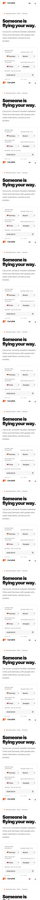

# CarryLink

**Someone is flying your way.**

[在线演示 / Live demo](https://carrylink-web.vercel.app/) · [GitHub](https://github.com/HaoWangOct/carrylink-web)

CarryLink 是连接中国与德国旅客和寄件人的跨境携带平台原型。本项目将 Figma 设计实现为可交互的多语言网页，用于展示产品体验和前端工程实践。

A multilingual marketplace prototype connecting travelers and senders between China and Germany. Built with Next.js, React, TypeScript and Tailwind CSS.

> **展示版 / Demo only:** 行程、匹配与订单使用模拟数据；刷新页面会重置演示状态。没有真实交易、付款、身份认证或物流服务。请勿输入真实密码、证件或其他敏感资料。公开托管时账户演示 API 保持禁用。


## 可以体验什么

- 中 / 英 / 德三语切换，适配桌面、平板与手机。
- 路线搜索、国家与城市联动、可分享的搜索 URL。
- 样例数据的确定性匹配、排序、匹配原因和空结果状态。
- 旅客创建、编辑、暂停、恢复演示行程。
- 寄件人分步填写需求、预览匹配、确认并查看演示订单。
- 本地注册与登录流程原型；线上不提供真实账户服务。
- 表单校验、键盘可用的对话框和响应式导航。

<details>
<summary>手机端预览 / Mobile preview</summary>



</details>

## 本地运行

需要 Node.js 22.13+ 和 npm。展示分支不需要数据库、支付密钥或第三方账户。

```sh
npm ci
npm run dev
```

打开 [http://127.0.0.1:3000](http://127.0.0.1:3000)。建议先体验首页搜索，再尝试创建行程或寄件需求。样例日期固定在 2026 年 9 月，属于演示数据。

| 页面 | 路径 |
| --- | --- |
| 首页与搜索 | `/` |
| 匹配结果 | `/matches` |
| 旅客控制台 | `/dashboard` |
| 创建行程 | `/trips/new` |
| 创建寄件需求 | `/requests/new` |
| 演示订单确认 | `/orders/review`（从匹配结果进入） |
| 演示订单详情 | `/orders/[id]`（创建后进入；刷新即重置） |
| 账户界面 | `/signup`、`/login`（完整模拟流程仅限本地开发） |

## 技术与目录

Next.js 16 App Router · React 19 · strict TypeScript · Tailwind CSS 4 · Playwright Core。

```text
src/app/          页面、布局与本地演示 API
src/components/   响应式界面与表单组件
src/content/      三语文案、城市与样例数据
src/mock/         浏览器内的演示状态与匹配逻辑
src/auth/         账户流程合约与校验
src/server/auth/  本地账户演示适配器
scripts/          检查脚本
docs/            架构、决策与任务记录
```

Inter 字体通过 `next/font/local` 自托管，许可证见 [OFL.txt](src/app/fonts/OFL.txt)。确切依赖版本以 `package-lock.json` 为准。

## 验证

```sh
npm run lint
npm run typecheck
npm run build
```

开发服务器启动后，另一个终端执行：

```sh
npm run test:browser
```

浏览器检查使用已安装的 Chrome / Edge / Chromium；必要时设置 `CHROME_PATH`，不会自动下载浏览器。覆盖 1440 / 768 / 390 / 320 px、三语切换、键盘对话框、搜索、旅客与寄件人流程及演示订单。报告与原始截图输出至忽略的 `artifacts/`。

## 在线展示

项目保留 Next.js 服务端路由，不能直接把源代码交给 GitHub Pages。使用支持 Next.js 的托管平台；Vercel 导入与设置见 [部署说明](docs/deployment.md)。公开演示：[carrylink-web.vercel.app](https://carrylink-web.vercel.app/)。

在线展示不需要环境密钥或数据库；不要设置 `CARRYLINK_AUTH_MODE=demo` 或启用本地数据库诊断入口。账户演示 API 同时限制为本机访问，公开站点显示账户服务不可用是预期行为。

## 设计与后续工作

视觉参考：[CarryLink Figma Make](https://www.figma.com/make/UlMimbPJrGzAYss4ohiJyd/Carrylink网站设计)，历史参考节点 `0:1`。本次整理沿用现有界面，没有重新设计页面或修改运营规则。

真实身份、数据库业务接入、支付、消息、交接与纠纷处理属于后续范围。正式运营仍需要明确的业务、隐私、海关和财务决策；原型不代表这些政策已获批准。

项目历史：[前端交互](docs/progress/2026-09-10.md) · [账户流程](docs/progress/2026-09-11-account-onboarding.md) · [架构决策](docs/decisions/README.md)。
